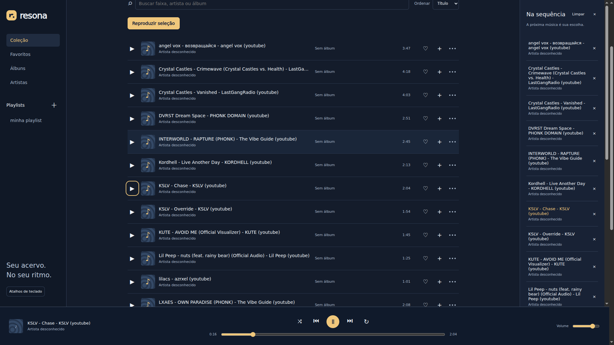
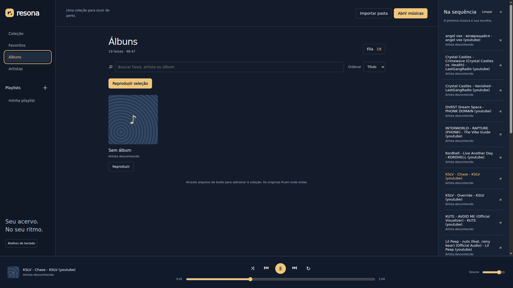

<p align="center">
  
</p>

<h1 align="center">Resona</h1>

<p align="center">
  <strong>Seu acervo. No seu ritmo.</strong><br>
  Suas músicas, organizadas em um player local para Windows e Linux.
</p>

<p align="center">
  <a href="https://github.com/thurdass/Resona/releases/latest">Baixar o Resona</a>
  &nbsp;·&nbsp;
  <a href="#conheça-o-resona">Capturas de tela</a>
  &nbsp;·&nbsp;
  <a href="#desenvolvimento">Desenvolvimento</a>
</p>

<p align="center">
  
  
  
</p>

---

Abra, selecione suas músicas e dê play. O **Resona** reúne coleção, favoritos,
álbuns, artistas e playlists em uma interface escura, com controles sempre à mão
e uma fila que acompanha sua escuta. Tudo funciona offline, sem conta, streaming
ou telemetria obrigatória.

## Conheça o Resona

### Sua coleção, pronta para tocar

Busque suas faixas, organize favoritos e monte a próxima sequência sem interromper
a música que está tocando.



### Um espaço para seus álbuns

Explore os álbuns da biblioteca e continue ouvindo enquanto navega entre as telas.
Capas e informações são lidas das tags dos arquivos; quando faltam, o Resona exibe
uma capa substituta e identifica os campos desconhecidos.



## Baixe e comece a ouvir

Os pacotes já incluem **Electron e PHP**. Para usar o aplicativo, você não precisa
instalar Node, Composer ou PHP separadamente.

| Sistema | Instalar | Usar sem instalador |
| --- | --- | --- |
| Windows x64 | [Instalador .exe](https://github.com/thurdass/Resona/releases/download/v0.1.3/Resona-0.1.3-win-x64.exe) | [Pacote .zip](https://github.com/thurdass/Resona/releases/download/v0.1.3/Resona-0.1.3-win-x64.zip) |
| Linux x64 | [Pacote .deb — Ubuntu/Debian](https://github.com/thurdass/Resona/releases/download/v0.1.3/Resona-0.1.3-linux-amd64.deb) | [Pacote .tar.gz](https://github.com/thurdass/Resona/releases/download/v0.1.3/Resona-0.1.3-linux-x64.tar.gz) |

[Ver todas as releases](https://github.com/thurdass/Resona/releases) ·
[Conferir SHA-256 dos pacotes](https://github.com/thurdass/Resona/releases/download/v0.1.3/SHA256SUMS.txt)

No Windows, execute o instalador ou extraia **todo o ZIP** e abra `resona.exe`.
O instalador ainda não tem assinatura digital e pode apresentar aviso de editor
desconhecido.

No Ubuntu/Debian, abra o `.deb` com o instalador de pacotes ou use:

```bash
sudo apt install ./Resona-0.1.3-linux-amd64.deb
```

O `.deb` configura o sandbox do Electron. No pacote `.tar.gz`, extraia os arquivos
e execute `resona`; a distribuição precisa oferecer bibliotecas gráficas/áudio e
suporte ao sandbox do Chromium. Os downloads estão no GitHub Releases; o Resona
ainda não foi publicado na Snap Store.

## Da pasta para o play

1. Clique em **Abrir músicas** para selecionar arquivos ou em **Importar pasta**
   para incluir uma pasta e suas subpastas. Você também pode arrastar os arquivos
   para a janela.
2. Escolha uma faixa ou clique em **Reproduzir seleção**. A importação não inicia
   a reprodução automaticamente.
3. Use **+** para adicionar músicas à fila e **×** para removê-las. O menu **•••**
   reúne as ações de playlist e remoção da coleção.

## Feito para sua biblioteca

| Recurso | O que você pode fazer |
| --- | --- |
| Coleção | Buscar por título, artista ou álbum e ordenar as faixas. |
| Favoritos e playlists | Guardar as preferidas e montar suas próprias seleções. |
| Fila | Adicionar, remover e acompanhar as próximas músicas. |
| Reprodução | Pausar, avançar, voltar, buscar na faixa e ajustar o volume. |
| Aleatório e repetição | Alternar a ordem e repetir uma faixa ou toda a fila. |
| Continuidade | Navegar entre as telas sem interromper o áudio. |
| Persistência | Reabrir com biblioteca, playlists, favoritos, fila e preferências salvos. |

**Seus arquivos continuam sendo seus.** O Resona referencia os originais: não
copia as músicas, não altera tags e não exclui arquivos pessoais. Remover uma
faixa da coleção só remove sua referência no aplicativo.

A importação evita duplicatas pelo caminho do arquivo. Cópias em pastas distintas
são itens distintos; arquivos movidos precisam ser importados novamente na nova
localização. Links simbólicos são ignorados.

**Formatos oferecidos:** MP3, FLAC, WAV, Ogg, Opus, M4A, AAC, AIFF e WebM.
A reprodução depende dos codecs suportados pelo Electron. Tags e capas
JPEG/PNG/WebP de até 5 MiB são lidas com getID3.

Biblioteca e preferências ficam no perfil do usuário, em SQLite. No Linux, o
local padrão é `~/.config/Resona` ou `$XDG_CONFIG_HOME/Resona`; no Windows,
`%APPDATA%/Resona`. Ao reabrir, o aplicativo aguarda sua ação para tocar.
A posição da faixa não é restaurada.

## Atalhos de teclado

| Atalho | Ação |
| --- | --- |
| `Espaço` | Pausar ou reproduzir |
| `←` / `→` | Voltar ou avançar 5 segundos |
| `↑` / `↓` | Aumentar ou diminuir o volume |
| `Alt` + `←` / `→` | Faixa anterior ou próxima |
| `Ctrl` + `O` | Abrir músicas |

Campos de texto e controles mantêm seu comportamento ao receber foco.
A interface mostra o foco de teclado e respeita a preferência por movimento
reduzido.

## Desenvolvimento

O Resona usa **Laravel 13, PHP 8.3, SQLite e Electron 44**, com JavaScript e CSS
locais. O shell desktop usa Electron diretamente; NativePHP não está instalado.

### Rodar a partir do código

Requisitos: PHP 8.3+ com PDO SQLite, mbstring, fileinfo, DOM/XML, tokenizer e
OpenSSL; Composer; Node 22.12+ e npm; uma sessão gráfica compatível com Electron.

```bash
composer run setup
npm run desktop
```

No Linux, você também pode iniciar com `./bin/resona`. O sandbox do Chromium
precisa estar configurado no ambiente de desenvolvimento.

O Electron inicia o Laravel em uma porta livre de `127.0.0.1` e encerra o servidor
junto com o aplicativo. `RESONA_PHP` permite escolher outro executável PHP;
`RESONA_DATA_DIR` define um perfil separado por caminho absoluto. Fontes, CSS e
JavaScript são locais, sem Vite ou downloads durante o uso.

### Gerar os pacotes

Execute o comando no sistema de destino, em arquitetura x64:

```bash
# Linux: .deb e .tar.gz
npm run package:linux

# Windows: instalador .exe e .zip
npm run package:windows
```

Os arquivos são gerados em `dist/release/`. O build inclui dependências PHP de
produção e baixa um runtime PHP fixado por commit e SHA-256, verificando suas
extensões. A construção precisa de rede ou caches disponíveis. Perfis de usuário,
bancos pessoais e músicas originais não entram no pacote.

### Validar

```bash
php artisan test --compact
npm run test:desktop
```

O [workflow de releases](.github/workflows/release.yml) também instala e executa
os pacotes em runners Windows e Linux, com sandbox habilitado e áudio WAV/FLAC
sintético. Ele verifica importação, deduplicação, persistência, fila, controles,
continuidade durante a navegação, arquivos indisponíveis e janela compacta,
gravando capturas e relatórios.

Os testes confirmam decodificação e avanço do tempo; **não confirmam saída audível
em caixas de som**. A seleção do diálogo é automatizada. A validação em runners
não certifica compatibilidade com todas as distribuições ou configurações de
hardware.

<details>
<summary><strong>Arquitetura e acesso aos arquivos</strong></summary>

Laravel/PHP centraliza metadados e persistência. O renderer do Electron permanece
isolado, com sandbox e uma ponte mínima para selecionar arquivos, selecionar
pastas e importar arquivos recebidos por arraste.

O processo principal autoriza importações com um segredo aleatório por execução.
O renderer usa IDs da biblioteca para acessar áudio e capas; não existe rota
pública de leitura por caminho arbitrário. Mutações exigem CSRF, pedidos externos
e permissões do renderer são bloqueados, e o servidor atende apenas loopback.

Um único elemento de áudio vive fora das telas, preservando a reprodução durante
a navegação. A biblioteca persiste em SQLite, independentemente das sessões HTTP.

O catálogo demo é apenas uma fixture histórica. Registros anteriores de
investigação não representam recursos incluídos no produto. Consulte as
[evidências da implementação local](docs/rea/local-player.md).

</details>

---

<p align="center"><strong>Resona · Seu acervo. No seu ritmo.</strong></p>
